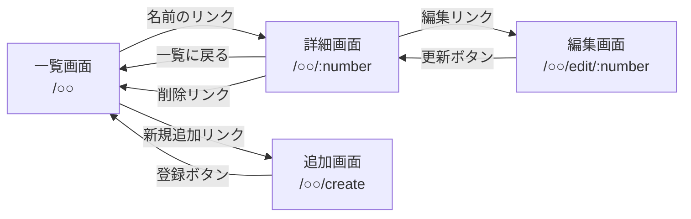

# レポート用システムの設計

25G1077 高瀬広夢

京葉線システム以外に，一覧表示をベースとした以下の3つのWebアプリケーションを開発する．
すべて `app5.js` と同じ構成（Node.js + Express + EJS）で作成し，データはサーバ内の変数（配列）に記録する．

| No. | システム名 | 対象 | URL |
|---|---|---|---|
| 1 | ドラえもんの秘密道具管理システム | ドラえもんの秘密道具 | `/doraemon` |
| 2 | ONE OK ROCK 楽曲リスト管理システム | ONE OK ROCKの楽曲 | `/oneokrock` |
| 3 | 今週のランチメニュー管理システム | 曜日ごとのランチメニュー | `/lunch` |

---

## 共通のページ遷移

3つのシステムは同じ画面構成とする．`○○` には `doraemon`，`oneokrock`，`lunch` が入る．

| 画面 | 内容 | 移動先 |
|---|---|---|
| 一覧画面 | 登録データのIDと名前を表で表示する | 名前のリンク → 詳細画面，「新規追加」 → 追加画面 |
| 詳細画面 | 選んだデータの全項目を表示する | 「編集」 → 編集画面，「削除」 → 削除して一覧画面，「一覧に戻る」 → 一覧画面 |
| 追加画面 | 新しいデータを入力するフォーム | 「登録」 → 保存して一覧画面 |
| 編集画面 | 既存データを書き換えるフォーム（現在の値を入力済みで表示） | 「更新」 → 保存して詳細画面 |

### 共通のルーティング（予定）

REST APIの詳細は次回以降の授業で説明されるため，内容は変更する可能性がある．

| メソッド | URL | 機能 |
|---|---|---|
| GET | `/○○` | 一覧表示 |
| GET | `/○○/create` | 追加画面の表示 |
| POST | `/○○` | データの追加 |
| GET | `/○○/:number` | 詳細表示 |
| GET | `/○○/edit/:number` | 編集画面の表示 |
| POST | `/○○/update/:number` | データの変更 |
| GET | `/○○/delete/:number` | データの削除 |

※ `/○○/create` は `/○○/:number` より前に書く（`create` が番号として解釈されるのを防ぐため）．

---

## システム1：ドラえもんの秘密道具管理システム

ドラえもんに登場する秘密道具の名前・効果・価格を管理する．

### スキーマ（変数名：`tools`）

| 項目名 | 型 | 内容 |
|---|---|---|
| id | 数値 | 道具ID（自動採番） |
| name | 文字列 | 道具名 |
| description | 文字列 | 効果・説明 |
| price | 文字列 | 参考価格（「不明」などもあるため文字列） |

---

## システム2：ONE OK ROCK 楽曲リスト管理システム

ONE OK ROCKの楽曲の曲名・収録アルバム・リリース年を管理する．

### スキーマ（変数名：`songs`）

| 項目名 | 型 | 内容 |
|---|---|---|
| id | 数値 | 楽曲ID（自動採番） |
| title | 文字列 | 曲名 |
| album | 文字列 | 収録アルバム |
| year | 数値 | リリース年 |

---

## システム3：今週のランチメニュー管理システム

1週間の曜日ごとのランチメニューと価格を管理する．

### スキーマ（変数名：`lunches`）

| 項目名 | 型 | 内容 |
|---|---|---|
| id | 数値 | メニューID（自動採番） |
| day | 文字列 | 曜日（例：月曜日） |
| menu | 文字列 | メニュー名 |
| price | 数値 | 価格（円） |
